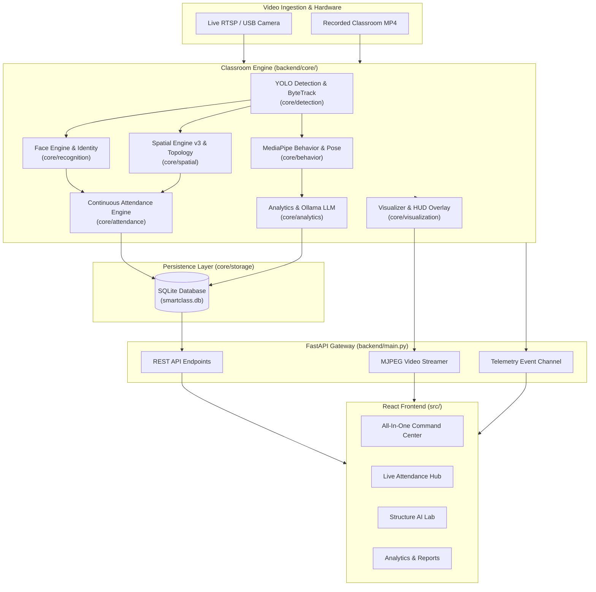

# 📚 SmartClass AI — Complete Technical Documentation

Welcome to the comprehensive technical documentation for **SmartClass AI**, an enterprise-grade, edge-first classroom intelligence system. SmartClass AI delivers real-time student face recognition, continuous presence verification, desk topology stabilization, multi-student behavior analysis, and automated session analytics—running 100% locally with zero cloud dependencies.

---

## 🧭 Documentation Map

| Section | Focus Area | Description |
| :--- | :--- | :--- |
| **[Architecture Overview](architecture/system_overview.md)** | System Design | High-level architecture, micro-modular domain model, and data flow. |
| **[Pipeline Architecture](architecture/pipeline_architecture.md)** | Video & Telemetry Pipeline | Multi-stage pipeline (`backend/core/pipeline/`), scheduling, and synchronization. |
| **[Spatial & Topology](architecture/spatial_topology.md)** | Classroom Geometry | Seating grid normalization, perspective slant handling, and Hungarian matching. |
| **[Backend Overview](backend/backend_overview.md)** | FastAPI Application | Server architecture, lifespan management, WebSocket feeds, and worker threads. |
| **[API Reference](backend/api_reference.md)** | REST & Streaming Endpoints | Full specification of all REST endpoints, MJPEG video streams, and telemetry feeds. |
| **[Core Engine](backend/core_engine.md)** | Orchestrator & State | `ClassroomEngine` (`backend/core/engine.py`), frame scheduler, and runtime state. |
| **[Subsystem: Detection](backend/modules/detection.md)** | Vision & Tracking | YOLOv8/11 person detection, ByteTrack tracking, and face crop extraction. |
| **[Subsystem: Recognition](backend/modules/recognition.md)** | Identity & Embeddings | Face detection, alignment, 512-D cosine embeddings, and roster matching. |
| **[Subsystem: Spatial Reasoning](backend/modules/spatial.md)** | Spatial Engine v3 | Coordinate normalization, seat associator, naming schemes, and anchor stabilizers. |
| **[Subsystem: Structure AI](backend/modules/structure.md)** | 3D & Depth Scene | Monocular depth estimation, geometric plane fitting, and automatic topology building. |
| **[Subsystem: Behavior Analysis](backend/modules/behavior.md)** | Attention & Posture | MediaPipe Face Landmarker, head pose PnP solver, EAR eye gaze, and activity classification. |
| **[Subsystem: Attendance Engine](backend/modules/attendance.md)** | Continuous Attendance | Verification tiers, temporal confirmation windows, and auto-checkout state machine. |
| **[Subsystem: Analytics & LLM](backend/modules/analytics.md)** | Reports & Ollama | Session metric aggregation, PDF/CSV reports, and local multimodal LLM labeling. |
| **[Subsystem: Storage & DB](backend/modules/storage.md)** | SQLite & ORM | Database schema, SQLAlchemy models, migration scripts, and persistence layer. |
| **[Subsystem: Visualization](backend/modules/visualization.md)** | Overlay & HUD | OpenCV visualizer, high-contrast HUD overlays, bounding box badges, and radar charts. |
| **[Frontend Overview](frontend/frontend_overview.md)** | React 18 & UI System | Dashboard architecture, dark glassmorphism design system, and state management. |
| **[Frontend Pages Guide](frontend/pages_guide.md)** | Application Views | Deep dive into all 9 pages: Attendance, Classroom, Structure Lab, Reports, etc. |
| **[Frontend API Client](frontend/api_client.md)** | Client-Side API Layer | Axios/Fetch wrapper (`src/api.js`), telemetry polling, and error handling. |
| **[Scripts & CLI Runners](scripts/runners_and_cli.md)** | Command-Line Tools | CLI tools (`cli.py`, `scan_classroom.py`, `run_video.py`, `run_webcam.py`, etc.). |
| **[Testing & Benchmarks](testing/testing_and_benchmarks.md)** | Verification & QA | Unit test suites, `brutal_test.py`, ground-truth benchmarks, and accuracy metrics. |
| **[Setup & Operations](deployment/setup_and_operations.md)** | Deployment Guide | System requirements, CUDA setup, Python environment, npm dependencies, and Ollama. |
| **[Diagnostic Reports](reports/PROJECT_SYSTEM_REPORT.md)** | Validation History | Historical diagnostic logs, spatial fix reports, and benchmark analysis. |

---

## 🏛️ High-Level System Architecture

SmartClass AI is built around a decoupled micro-modular architecture combining edge deep learning, spatial geometry, and reactive web interfaces:



---

## ⚡ Core Philosophy & Key Differentiators

1. **100% Local & Privacy-Preserving**: All face embeddings, eye tracking, and behavior predictions run on edge hardware (NVIDIA GPU or modern CPU). No video frames or biometric signatures are sent to third-party cloud servers.
2. **Deterministic Seating Stability**: Classroom seating uses normalized perspective coordinates and Hungarian bipartite matching, ensuring student identifiers and seat names remain stable even during head movements, occlusions, or standing.
3. **Temporal Attendance Verification**: Replaces brittle single-frame recognition with continuous temporal observation windows (30-second confirmation, 120-second absence grace period, 3-tier confidence model).
4. **Multi-Modal Behavior Scoring**: Combines 478 MediaPipe facial landmarks, Perspective-n-Point (PnP) head pose estimation, Eye Aspect Ratio (EAR), and motion cues to deliver a holistic 0–100% student attentiveness metric.
5. **Local LLM Pedagogical Insights**: Integrates with local Ollama instances (LLaVA / Llama 3) to translate raw numerical attention statistics into actionable classroom instructional feedback.

---

## 📁 Repository Directory Structure

```text
classroom/
├── backend/                         # FastAPI Python Backend
│   ├── core/                        # Enterprise Modular Domain Subsystems
│   │   ├── analytics/               # Session metrics & Ollama LLM integration
│   │   ├── attendance/              # Continuous temporal attendance engine
│   │   ├── behavior/                # MediaPipe pose, gaze & behavior tracker
│   │   ├── detection/               # YOLO person detector & ByteTrack
│   │   ├── pipeline/                # Multi-stage asynchronous pipeline
│   │   ├── recognition/             # Face recognition & cosine embeddings
│   │   ├── scene/                   # Scene state representation
│   │   ├── spatial/                 # Seating topology & coordinate normalization
│   │   ├── storage/                 # SQLAlchemy database models & transactions
│   │   ├── structure/               # 3D Depth & geometric classroom builder
│   │   ├── visualization/           # OpenCV HUD annotator & frame rendering
│   │   ├── config.py                # Global hyperparameters & settings
│   │   ├── engine.py                # ClassroomEngine orchestrator
│   │   └── __init__.py              # Package entry & domain exports
│   ├── experiments/                 # Experimental algorithms & dual-benchmarks
│   ├── main.py                      # FastAPI server & route handlers
│   ├── migrate_attendance_v1_1.py   # Database migration utility
│   └── requirements.txt             # Python dependencies
├── benchmarks/                      # Performance & association benchmarking suite
├── docs/                            # Technical Documentation (You are here)
│   ├── architecture/                # System diagrams & architectural designs
│   ├── backend/                     # Backend API & subsystem technical guides
│   ├── frontend/                    # React UI & client-side documentation
│   ├── scripts/                     # Standalone CLI tools & scripts guide
│   ├── testing/                     # Test suites & benchmark guides
│   ├── deployment/                  # Setup, hardware, and installation guide
│   └── reports/                     # Historical benchmark and diagnostic reports
├── models/                          # Pre-trained models (MediaPipe, YOLO weights)
├── outputs/                         # Generated plots, layouts & analysis reports
├── public/                          # Static assets for React Vite frontend
├── src/                             # React 18 Frontend Application
│   ├── pages/                       # Dashboard, Attendance, StructureLab, etc.
│   ├── api.js                       # Frontend API client
│   ├── App.jsx                      # App component, routing, and navigation
│   ├── index.css                    # Design system (Dark glassmorphism styles)
│   └── main.jsx                     # Vite React root mount
├── tests/                           # Diagnostic test suite (65+ tests)
├── cli.py                           # Unified command line tool
├── run_video.py                     # Offline classroom video analyzer
├── run_webcam.py                    # Realtime webcam surveillance pipeline
├── run_classroom_analysis.py        # High-level full pipeline execution
├── scan_classroom.py                # Automatic classroom topology scanner
├── package.json                     # Frontend npm packages
└── vite.config.js                   # Vite configuration
```

---

## 🚀 Quick Navigation Guide

- **Setting up your local environment?** Read [Setup & Operations](deployment/setup_and_operations.md).
- **Understanding how faces and students are tracked?** Read [Recognition Engine](backend/modules/recognition.md) and [Attendance Engine](backend/modules/attendance.md).
- **Debugging seat assignments or coordinate shifts?** Read [Spatial Reasoning](backend/modules/spatial.md) and [Structure AI](backend/modules/structure.md).
- **Exploring the REST & Streaming API?** Read [API Reference](backend/api_reference.md).
- **Running tests or verifying system accuracy?** Read [Testing & Benchmarks](testing/testing_and_benchmarks.md).
