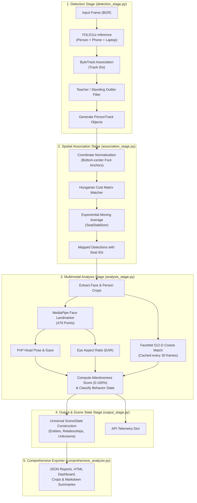

# 🔄 Video & Telemetry Pipeline Architecture

The processing core of SmartClass AI is built upon an asynchronous, multi-tiered pipeline located in `backend/core/pipeline/`. It decouples high-frequency geometric tracking from computationally heavier tasks like face landmarking, embedding extraction, and multimodal scene reasoning.

---

## ⏱️ Tiered Execution Cadence

To guarantee smooth real-time performance ($\ge 25$ FPS on GPU, $\ge 15$ FPS on CPU), the pipeline partitions work across four cadences managed by `PipelineScheduler` ([scheduler.py](file:///c:/Users/rajea/Documents/classroom/backend/core/pipeline/scheduler.py)):

| Tier | Cadence | Modules / Operations | Rationale |
| :--- | :--- | :--- | :--- |
| **FAST Tier** | Every Frame ($k=1$) | • YOLO11s Person & Device Detection • ByteTrack Multi-Target Association • Spatial Seat Projection | Low latency required for bounding box tracking and spatial stabilization. |
| **MEDIUM Tier** | Every Frame / $k=1$ (or 2 on low-power CPU) | • MediaPipe FaceLandmarker (478 pts) • Head Pose (Yaw/Pitch/Roll via PnP) • Eye Aspect Ratio (EAR) & Gaze Vectors | Essential for fine-grained attention scoring and blink rate estimation. |
| **SLOW Tier** | Every 30 Frames ($n=30$, ~1s) | • FaceNet / InsightFace Embedding Generation • Cosine Identity Matching against Roster • Prototype Cache Updating | Biometric identities remain invariant over continuous classroom sessions. |
| **ASYNC Tier** | Every 90 Frames (~3s) | • Multimodal VLM (Ollama LLaVA / Llama 3) • Scene summary & pedagogical advice generation | Non-blocking background worker thread; handles slow generative LLM calls. |

---

## 🏗️ Multi-Stage Pipeline Breakdown

---

## 🔍 Detailed Stage Specifications

### Stage 1: Detection Stage (`DetectionStage`)
*File: [detection_stage.py](file:///c:/Users/rajea/Documents/classroom/backend/core/pipeline/detection_stage.py)*

1. **Inference**: Invokes `detect_faces_and_phones(frame, min_conf=YOLO_CONF, persist=True)`.
2. **Object Filtering**:
   - Detects and outputs peripheral items: `phones`, `laptops`, `earphones`.
   - Calculates relative bounding box height vs frame height. If $\frac{h_{\text{bbox}}}{H_{\text{frame}}} > 0.65$ and $y_{\text{top}} < 0.22 \times H_{\text{frame}}$, the entity is categorized as a standing instructor and excluded from student seat mapping.
3. **Torso De-duplication**: Identifies nested or duplicate bounding boxes (e.g. torso vs full-body proposals) via Intersection-over-Union (IoU) containment and keeps the maximal informative context box.
4. **Track Formulation**: Instantiates `PersonTrack` objects encapsulating `track_id`, bounding box coordinates, and temporal history.

### Stage 2: Association Stage (`AssociationStage`)
*File: [association_stage.py](file:///c:/Users/rajea/Documents/classroom/backend/core/pipeline/association_stage.py)*

1. **Physical Seat Anchor Projection**: Computes the candidate contact point $(c_x, y_{\text{bottom}})$ for each student detection.
2. **Hungarian Bipartite Matching**:
   - Computes an $N \times M$ Euclidean cost matrix between normalized student contact points and calibrated seat anchors:
     $$C_{ij} = \sqrt{(x_i - x_j)^2 + (y_i - y_j)^2} + \lambda_{\text{prev}} \cdot \mathbb{I}(\text{seat}_i \ne \text{prev\_seat}_j)$$
   - Solves optimal linear sum assignment using SciPy's `linear_sum_assignment`.
3. **Ghost Tracking & Hysteresis**:
   - If a student momentarily occludes or steps away, a "ghost" assignment keeps the seat assigned for up to 15 frames before marking it vacant.
   - Smooths bounding box edges via `SeatStabilizer` using dynamic exponential weighting ($\alpha = 0.70$).

### Stage 3: Multimodal Analysis Stage (`analysis_stage.py`)
*File: [analysis_stage.py](file:///c:/Users/rajea/Documents/classroom/backend/core/pipeline/analysis_stage.py)*

1. **Facial Landmark Regression**:
   - Executes MediaPipe `FaceLandmarker` with Iris models.
   - Computes 3D head rotation matrix via Levenberg-Marquardt PnP solver against standard 3D anthropometric face models.
2. **Attention Synthesis**:
   - Combines pitch/yaw penalties, eye openness (EAR), and body activity:
     $$\text{Score} = 100 \times \left( 0.40 \cdot \cos(\theta_{\text{yaw}}) + 0.30 \cdot \cos(\theta_{\text{pitch}}) + 0.20 \cdot \frac{\text{EAR}}{0.32} + 0.10 \cdot (1 - \text{jitter}) \right)$$
3. **Identity Association**:
   - On scheduled slow frames, crops the face region, extracts 512-D embeddings, and evaluates cosine similarity against active enrolled students in the database.
4. **Temporal State History**:
   - Updates student sliding history buffer (stores last 30 frames). Computes moving trend indicators (`UP`, `DN`, `STDY`).

### Stage 4: Output & Scene Construction (`OutputStage`)
*File: [output_stage.py](file:///c:/Users/rajea/Documents/classroom/backend/core/pipeline/output_stage.py)*

1. **Scene Representation**: Constructs an immutable `SceneState` object capturing:
   - `entities`: Individual students with confidence, seat label, attentiveness, and pose.
   - `relationships`: Interactions such as student-to-phone contact, student-to-neighbor orientation (e.g. whispering/talking).
   - `unknowns`: Desks occupied by unverified visitors.
2. **Telemetry Serialization**: Prepares lightweight JSON payloads for immediate broadcast over WebSocket / SSE to connected frontend dashboards.

### Stage 5: Comprehensive Exporter (`ComprehensiveExporter`)
*File: [comprehensive_analyzer.py](file:///c:/Users/rajea/Documents/classroom/backend/core/pipeline/comprehensive_analyzer.py)*

Generates a forensic offline artifact directory for every analyzed classroom session:
1. `00_clean_frame.jpg` to `06_validation_overlay.jpg`: Step-by-step visual proofs of structural recognition.
2. `classroom_topology.json`: Calibrated physical seating coordinates.
3. `classroom_analysis_report.json`: Master execution analytics and metrics.
4. `students_data.json`: Comprehensive per-student longitudinal logs.
5. `students/crops/<seat_id>_occupant.jpg`: High-resolution face/torso crops of each student.
6. `classroom_dashboard.html`: Self-contained interactive single-file HTML dashboard with embedded charts.
7. `CLASSROOM_ANALYSIS_REPORT.md`: Printable executive markdown summary.
