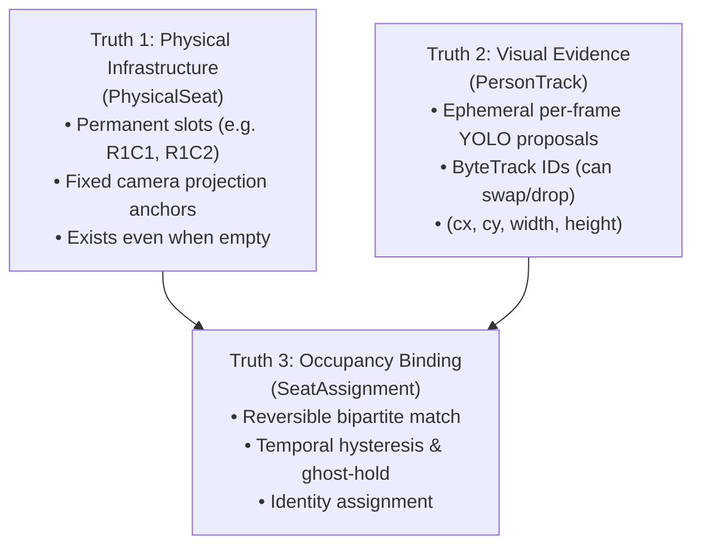
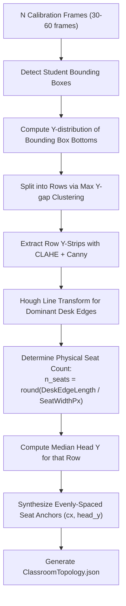

# 🪑 Classroom Spatial Reasoning & Topology

In a multi-student classroom, naive bounding-box tracking suffers from severe identity switching whenever students lean, turn around, or temporarily stand up. SmartClass AI solves this through a **Decoupled Spatial Perception Model** that separates physical infrastructure from ephemeral computer vision tracks.

---

## 🏛️ The Three Truths of Classroom Perception

1. **Truth 1: Physical Infrastructure (`PhysicalSeat`)**: Fixed classroom slots defined by room architecture and camera perspective. Persists regardless of whether a student is present.
2. **Truth 2: Ephemeral Visual Detections (`PersonTrack`)**: YOLO detections and ByteTrack track IDs that can flicker, drop, or occlude.
3. **Truth 3: Occupancy Binding (`SeatAssignment`)**: A dynamic, temporally smoothed association linking a visual detection to a physical seat slot.

---

## 📐 Spatial Perception V3 Discovery Pipeline

Rather than requiring manual annotation or hardcoded grid dimensions, `SpatialEngineV3` ([spatial_engine_v3.py](file:///c:/Users/rajea/Documents/classroom/backend/core/spatial/spatial_engine_v3.py)) automatically estimates the full classroom geometry during calibration:

### Algorithmic Parameters
- `_SEAT_WIDTH_PX`: Nominal width of a physical seat slot at $1920 \times 1080$ ($\sim 300\text{ px}$).
- `_MAX_ANGLE_DEG`: Maximum permissible deviation from horizontal for desk edges ($10.0^\circ$).
- `_BAND_MERGE_PX`: Threshold for merging collinear desk line segments ($25\text{ px}$).
- `_STRIP_PAD`: Vertical search band padding around row cluster bounds ($80\text{ px}$).

---

## 🔗 Seat Association & Hysteresis Logic

The `SeatAssociator` ([seat_associator.py](file:///c:/Users/rajea/Documents/classroom/backend/core/spatial/seat_associator.py)) binds candidate `PersonTrack` instances to physical anchors using a multi-constraint optimization model:

### 1. Cost Function with Hysteresis
To prevent seats from alternating between neighboring students:

$$C(i, j) = D(T_i, S_j) - H_{\text{bonus}} \cdot \mathbb{I}(S_j == \text{prev\_seat}(T_i))$$

Where:
- $D(T_i, S_j)$ is the Euclidean distance between track contact anchor and seat anchor.
- $H_{\text{bonus}} = 45\text{ px}$ is the hysteresis credit applied when a track retains its existing seat.
- Maximum valid matching radius: $\text{SEAT\_MAX\_DISTANCE\_PX} = 380\text{ px}$.

### 2. Multi-Tier Matching Waterfall
1. **Tier 1 (Exact Region Match)**: Detections falling directly within calibrated seat bounding boxes.
2. **Tier 2 (Overlap Region Match)**: Bounding boxes that intersect $> 40\%$ with seat interaction zones.
3. **Tier 3 (Hungarian Global Match)**: Munkres bipartite assignment across remaining tracks and vacant seats.
4. **Tier 4 (Ghost Hold)**: When a track drops out (e.g. temporary occlusion), the seat assignment is preserved as a `GHOST` state for up to $8$ frames (`GHOST_HOLD_FRAMES`).
5. **Tier 5 (Unassigned)**: Outlier tracks (e.g. standing visitor, walking teacher) receive status `UNASSIGNED` without distorting the physical grid.

---

## 🏷️ Standardized Seat Naming Conventions

Managed by `backend/core/spatial/seat_naming.py`:

| Coordinate Format | Sample Label | Meaning |
| :--- | :--- | :--- |
| **Grid Cell** | `R1C1` | Row 1 (front row), Column 1 (leftmost desk). |
| **Bench Nomenclature** | `R1-B1-L` | Row 1, Bench 1, Left seat position. |
| **Numeric ID** | `101` | Formula: $100 \times \text{Row} + \text{Col}$. |
| **Display Name** | `Seat 1` | Left-to-right classroom order (1 through $N$). |

---

## 🔄 Dynamic Stabilization (`SeatStabilizer`)

Even with stable tracking, raw bounding boxes exhibit frame-to-frame pixel noise. `SeatStabilizer` ([stabilizer.py](file:///c:/Users/rajea/Documents/classroom/backend/core/spatial/stabilizer.py)) applies an Exponential Moving Average (EMA) to all bounding box coordinates:

$$\vec{B}_t = \alpha \vec{B}_{\text{measured}} + (1 - \alpha) \vec{B}_{t-1}$$

- $\alpha = 0.70$ during regular tracking (rapid responsiveness).
- $\alpha = 0.30$ during subtle head turns (prevents bounding box jitter).
- Velocity thresholding suppresses single-frame outlier jumps $> 60\text{ px}$.
