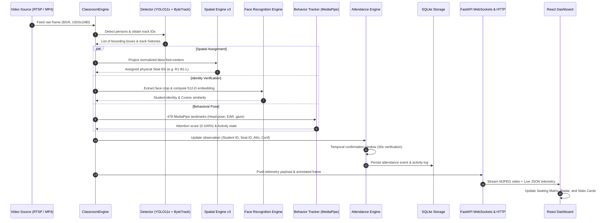

# 🏛️ System Architecture Overview

SmartClass AI is an offline, multi-modal classroom intelligence platform designed to process live or recorded classroom video streams. It computes continuous attendance, stable desk assignments, per-student behavioral attention metrics, and automated instructional summaries.

---

## 📐 Architecture Principles

The architecture follows strict core engineering principles:

1. **Edge-First Autonomy**: Operates on edge compute with NVIDIA CUDA or CPU fallback. Zero dependencies on external cloud APIs for video processing, face recognition, or inference.
2. **Domain-Driven Modularization**: The backend is partitioned into dedicated domain packages (`backend/core/`):
   - `detection/`: Object proposals & temporal tracking
   - `recognition/`: Identity verification & biometric embeddings
   - `spatial/`: Geometric projection, desk stabilization, and grid topologies
   - `structure/`: Monocular depth maps and geometric 3D scene estimation
   - `behavior/`: Multi-landmark posture, gaze, and attention scoring
   - `attendance/`: Temporal state machine & presence persistence
   - `analytics/`: Aggregate statistics & local Ollama LLM queries
   - `storage/`: Relational persistence & transactional ACID guarantees
   - `visualization/`: High-performance video overlays & canvas rendering
   - `pipeline/`: Stage-based decoupled processing queues
3. **Deterministic Spatial Stability**: Avoids fluctuating student IDs by binding individuals to stable, physical classroom coordinates (Row $\times$ Bench $\times$ Position).
4. **Resilient Temporal Filtering**: Uses sliding observation windows, Exponential Moving Averages (EMA), and confidence thresholds to eliminate single-frame noise or flicker.

---

## 🔄 End-to-End Data Flow

---

## 🧩 Domain Packages Breakdown

### 1. `backend/core/detection`
- **Primary Class**: `ClassroomDetector` ([detector.py](file:///c:/Users/rajea/Documents/classroom/backend/core/detection/detector.py))
- **Responsibilities**:
  - Ingests video frames and runs Ultralytics YOLO11s/YOLOv8 to isolate `person` class instances.
  - Couples raw detections with ByteTrack algorithm to assign continuous `track_id` values across successive frames.
  - Crops normalized head and face regions based on anatomical upper-body heuristics.

### 2. `backend/core/recognition`
- **Primary Classes**: `FaceEngine` ([face_engine.py](file:///c:/Users/rajea/Documents/classroom/backend/core/recognition/face_engine.py)), `FaceRecognitionEngine` ([face_recognition_engine.py](file:///c:/Users/rajea/Documents/classroom/backend/core/recognition/face_recognition_engine.py))
- **Responsibilities**:
  - Aligns facial bounding boxes and extracts deep facial embeddings (FaceNet / InsightFace 512-D float vectors).
  - Maintains in-memory cache of registered students with average prototypes.
  - Performs Cosine Similarity lookup:
    $$\text{Similarity}(u, v) = \frac{u \cdot v}{\|u\| \|v\|}$$
  - Verification thresholding: Strict ($\ge 0.50$) vs Relaxed Candidate ($\ge 0.40$).

### 3. `backend/core/spatial`
- **Primary Classes**: `SpatialEngineV3` ([spatial_engine_v3.py](file:///c:/Users/rajea/Documents/classroom/backend/core/spatial/spatial_engine_v3.py)), `ClassroomTopology` ([topology.py](file:///c:/Users/rajea/Documents/classroom/backend/core/spatial/topology.py)), `SeatAssociator` ([seat_associator.py](file:///c:/Users/rajea/Documents/classroom/backend/core/spatial/seat_associator.py)), `SeatStabilizer` ([stabilizer.py](file:///c:/Users/rajea/Documents/classroom/backend/core/spatial/stabilizer.py))
- **Responsibilities**:
  - Normalizes pixel coordinates to account for camera slant angles and vanishing-point perspective distortion.
  - Automatically identifies row structures using density-based $y$-clustering.
  - Resolves person-to-seat assignment using the Hungarian (Munkres) minimum cost matching algorithm.
  - Stabilizes seat anchor locations using Exponential Moving Average filters to prevent jitter.

### 4. `backend/core/behavior`
- **Primary Classes**: `BehaviorTracker` ([behavior_tracker.py](file:///c:/Users/rajea/Documents/classroom/backend/core/behavior/behavior_tracker.py)), `StudentState` ([student_state.py](file:///c:/Users/rajea/Documents/classroom/backend/core/behavior/student_state.py))
- **Responsibilities**:
  - MediaPipe FaceLandmarker tracks 478 3D facial landmarks per student.
  - Solves Perspective-n-Point (PnP) problem using 3D canonical facial model points to calculate Euler angles: Yaw, Pitch, Roll.
  - Computes Eye Aspect Ratio (EAR) for blink rate and drowsiness detection:
    $$\text{EAR} = \frac{\|p_2 - p_6\| + \|p_3 - p_5\|}{2 \|p_1 - p_4\|}$$
  - Synthesizes 0–100% attention score from weighted components:
    $$\text{Attention} = w_{\text{pose}} S_{\text{pose}} + w_{\text{eyes}} S_{\text{eyes}} + w_{\text{motion}} S_{\text{motion}}$$
  - Classifies student state into discrete behavior labels: `studying`, `attentive`, `talking`, `distracted`, `drowsy`, `sleeping`, `phone`.

### 5. `backend/core/attendance`
- **Primary Class**: `AttendanceEngine` ([attendance_engine.py](file:///c:/Users/rajea/Documents/classroom/backend/core/attendance/attendance_engine.py))
- **Responsibilities**:
  - Multi-tiered verification state machine:
    - **Tier 1 (VERIFIED)**: Continuous face identity match for $\ge 30$ seconds.
    - **Tier 2 (UNVERIFIED)**: Temporary person detected without confirmed identity.
    - **Tier 3 (FLAGGED / ABSENT)**: Unidentified person in a registered seat or absent for $> 120$ seconds.
  - Automatic check-in and checkout timestamps.
  - Real-time attendance ledger synchronized with SQLite.

### 6. `backend/core/analytics`
- **Primary Classes**: `ReportGenerator` ([report_generator.py](file:///c:/Users/rajea/Documents/classroom/backend/core/analytics/report_generator.py)), `OllamaLabeler` ([ollama_labeler.py](file:///c:/Users/rajea/Documents/classroom/backend/core/analytics/ollama_labeler.py))
- **Responsibilities**:
  - Computes aggregate session metrics: Class Average Attention, Peak Attention, Focus Distribution, Drowsiness Incident Log.
  - Interacts with local Ollama service (LLaVA / Llama 3) via HTTP API to provide natural-language instructional observations and pedagogical suggestions.

### 7. `backend/core/storage`
- **Primary Module**: [database.py](file:///c:/Users/rajea/Documents/classroom/backend/core/storage/database.py)
- **Responsibilities**:
  - SQLAlchemy ORM engine over SQLite (`smartclass.db`).
  - Thread-safe session scoping with `SessionLocal` and FastAPI dependency injection (`get_db`).
  - Data models: `Student`, `AttendanceRecord`, `ActivityLog`, `Session`, `SessionReport`, `SeatingConfig`.

---

## 💻 Tech Stack Summary

| Layer | Component | Technology |
| :--- | :--- | :--- |
| **Edge Vision** | Object & Person Detection | YOLO11s / YOLOv8 (PyTorch / ONNX) |
| **Object Tracking** | Multi-target Tracking | ByteTrack (Kalman Filter + Hungarian) |
| **Biometrics** | Facial Embeddings | InsightFace / FaceNet (512-D Cosine Sim) |
| **Facial Analysis** | Posture, Gaze & EAR | Google MediaPipe Face Landmarker (478 pts) |
| **Backend API** | High-performance Web Framework | FastAPI (Python 3.10+) + Uvicorn |
| **Database** | Persistent Relational Storage | SQLite 3 via SQLAlchemy ORM |
| **Local LLM** | Multimodal Classroom Diagnostics | Ollama (LLaVA / Llama 3 / Mistral) |
| **Frontend UI** | Modern Reactive Dashboard | React 18, Vite, React Router 6 |
| **UI Aesthetics** | Dark Glassmorphism Design System | Vanilla CSS (Tokens, CSS Variables, Flex/Grid) |
| **Icons & Visuals** | Vector Graphic Components | Lucide React |
