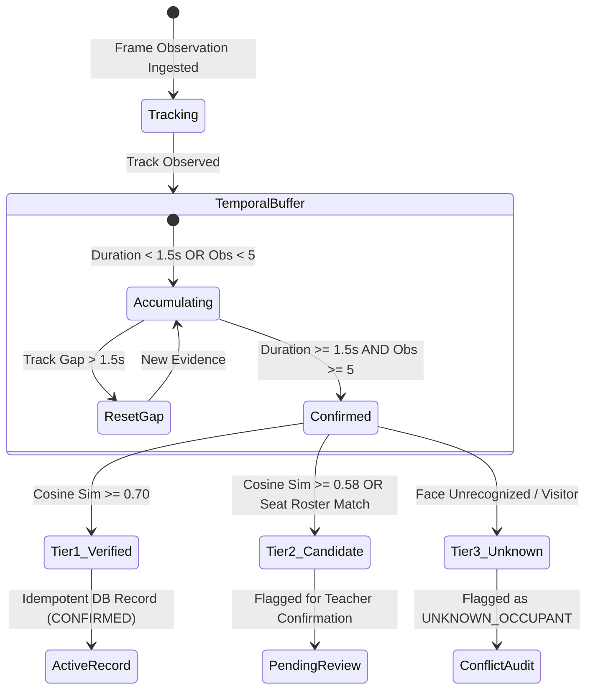

# 📋 Continuous Attendance Subsystem (`backend/core/attendance/`)

The Attendance subsystem ([attendance_engine.py](file:///c:/Users/rajea/Documents/classroom/backend/core/attendance/attendance_engine.py)) replaces unreliable single-frame snapshots with an enterprise-grade, continuous presence decision engine. It enforces temporal confirmation windows, 3-tier identity resolution, thread-safe idempotency, and audit trails.

---

## 🏛️ Verification State Machine

---

## 🛡️ The 3 Identity Resolution Tiers

### Tier 1: Biometrically Verified (`TIER_1_VERIFIED`)
- **Condition**: Face crop yields Cosine similarity $\ge 0.70$ with registered enrolled student.
- **Action**: Instantly records attendance as `PRESENT`. Updates database timestamps `first_seen` and `last_seen`.
- **Audit**: Increments student `total_attendance` count.

### Tier 2: Seat-Based Candidate (`TIER_2_CANDIDATE`)
- **Condition**: Borderline biometric similarity ($0.58 \le \text{Sim} < 0.70$) OR physical occupant matches the assigned seat roster for that desk.
- **Action**: Recorded with status `CANDIDATE` and flagged `needs_review = True`.
- **Instructor Action**: Instructor can review in dashboard and confirm with one click.

### Tier 3: Unknown Occupant (`TIER_3_UNKNOWN`)
- **Condition**: Student identity cannot be verified (guest, unregistered student, or visitor).
- **Action**: Nullable `student_id = None`, recorded as `UNKNOWN_OCCUPANT` with desk location.
- **Audit**: Prevents falsifying official student records while maintaining complete physical occupancy records.

---

## ⏱️ Temporal Window & Continuity Rules

- `confirmation_duration_sec = 1.5s`: Minimum sustained presence required before committing to the database.
- `min_observations = 5`: Minimum discrete frame detections required.
- `max_gap_sec = 1.5s`: If tracking is lost for $> 1.5\text{s}$, the temporal confirmation counter resets.
- **Auto-Checkout**: If a student is absent continuously for $> 120\text{ seconds}$, the active presence window is closed and a checkout timestamp is committed.

---

## 🔒 Thread Safety & Concurrency

- **Locking**: Protected via `threading.Lock()` to prevent race conditions during concurrent REST requests and background stream workers.
- **Dry-Run Isolation**: If `dry_run=True` (e.g. during test video runs or student profile previews), `is_dry_run = 1` is recorded in SQLite and official lifetime student statistics remain unmutated.
- **Database Idempotency**: Prevents duplicate attendance records within the same session/date using composite unique checks on `(session_id, student_id, date)`.
