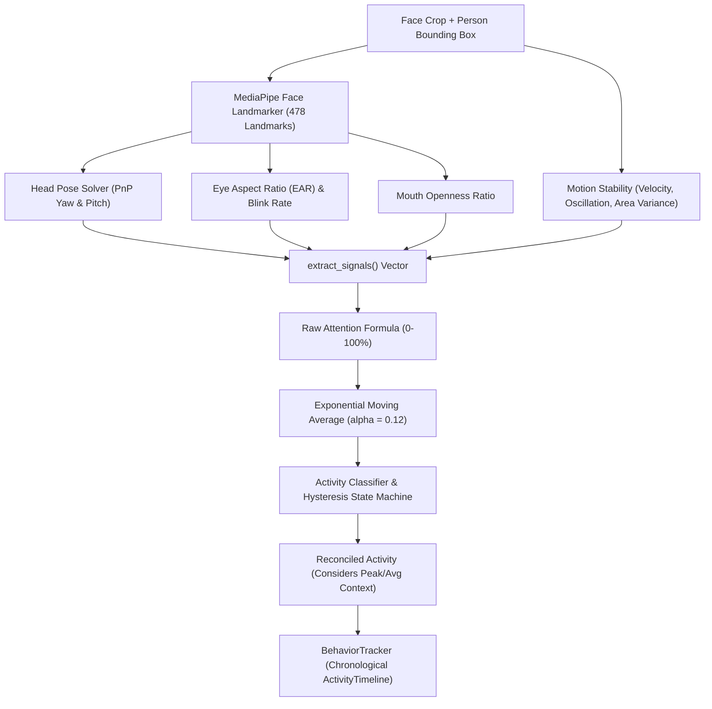

# 🧘 Behavior & Attention Subsystem (`backend/core/behavior/`)

The Behavior subsystem computes transparent, fair, and multi-modal student attention metrics without crude single-frame thresholding. It integrates 478 MediaPipe facial keypoints, 3D head pose estimation, Eye Aspect Ratio (EAR), motion stability, and device interaction counters into an Exponential Moving Average score.

---

## 🏛️ Subsystem Architecture

---

## 📐 Attention Score Calculation

Attention is calculated through balanced physiological and behavioral signals:

### 1. Head Pose Score ($60\%$ Weight)
Solves Perspective-n-Point (PnP) using 3D anthropometric face models:
- **Yaw Tolerance**: In real classrooms, students look across whiteboards and projectors. Yaw is only penalized beyond $\pm 35^\circ$:
  $$S_{\text{yaw}} = 1.0 - \min\left(1.0, \frac{\max(0.0, |\theta_{\text{yaw}}| - 35^\circ)}{25^\circ}\right)$$
- **Pitch Tolerance**: Writing in notebooks or reading requires natural downward gaze. Pitch is only penalized beyond $\pm 25^\circ$:
  $$S_{\text{pitch}} = 1.0 - \min\left(1.0, \frac{\max(0.0, |\theta_{\text{pitch}}| - 25^\circ)}{25^\circ}\right)$$
- Composite Pose: $S_{\text{pose}} = 0.60 S_{\text{yaw}} + 0.40 S_{\text{pitch}}$.

### 2. Motion Stability Score ($25\%$ Weight)
Evaluates physical fidgeting, slouching, and head oscillation:
$$S_{\text{motion}} = 0.35 S_{\text{vel}} + 0.25 S_{\text{osc}} + 0.25 S_{\text{area}} + 0.15 S_{\text{drift}}$$

### 3. Eye Openness Score ($15\%$ Weight)
Computes Eye Aspect Ratio (EAR) across 6 eye landmarks per eye:
$$\text{EAR} = \frac{\|p_2 - p_6\| + \|p_3 - p_5\|}{2 \|p_1 - p_4\|}$$
- Eye penalty is applied only if $\text{EAR} < 0.30$ (distinguishing normal squinting from drowsy drooping).

---

## 🏷️ Activity Classification State Machine

Evaluates signals through a $5$-frame hysteresis buffer (`HYSTERESIS_FRAMES = 5`) to prevent flicker:

| Activity Label | Classification Rules |
| :--- | :--- |
| `studying` | Downward pitch (reading/writing angle) + stable posture + high attention score ($\ge 75\%$). |
| `attentive` | Forward/board-facing yaw + steady head pose + attention score ($\ge 65\%$). |
| `talking` | Sustained mouth opening ratio $> 0.22$ + sideways yaw toward neighboring peer. |
| `phone` | Cell phone detected within student bounding box for $\ge 3$ consecutive frames. |
| `laptop` | Laptop active on desk with forward-leaning typing posture. |
| `distracted` | Extreme yaw $> 45^\circ$ or continuous rapid head oscillation without engagement. |
| `drowsy` | Eyes closed ($\text{EAR} < 0.20$) or slumped head posture for $> 1.5$ seconds. |
| `sleeping` | Continuous head resting on desk with absent face visibility for $> 5$ seconds. |

---

## ⚖️ Contextual Reconciliation (`reconciled_activity`)

To ensure students are not unfairly penalized for natural classroom moments:
- If session average $\ge 80\%$, momentary distraction is recorded as: `"briefly distracted"` while preserving primary `"studying"` status.
- If peak $\ge 78\%$ and session average $\ge 60\%$, transient turning is reported as `"naturally varying attention"`.
- Transparent disclaimer: *Observable engagement proxy based on head pose and eye openness—not cognitive comprehension.*
