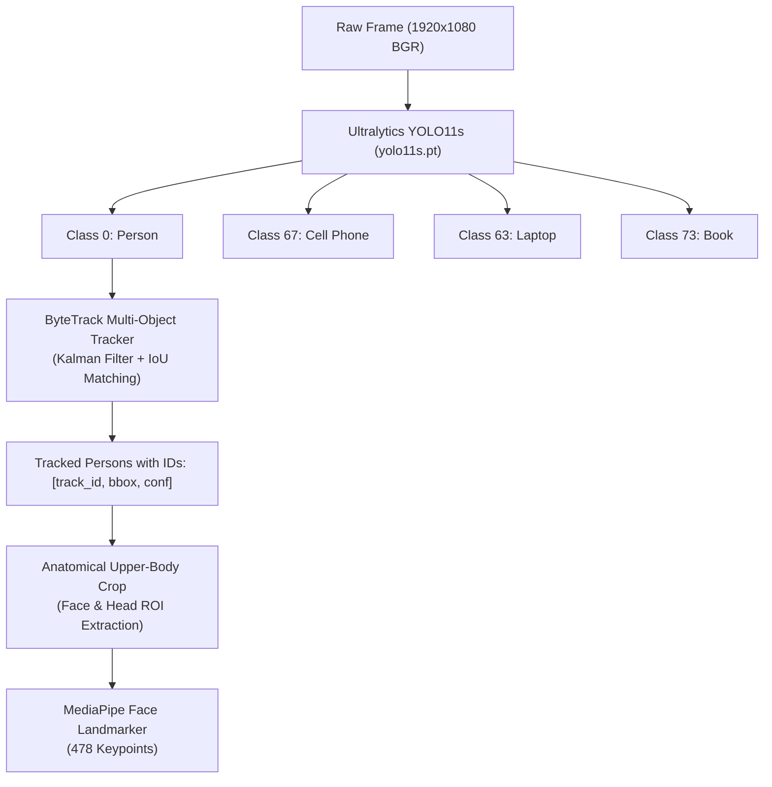

# 🎯 Detection Subsystem (`backend/core/detection/`)

The Detection module ([detector.py](file:///c:/Users/rajea/Documents/classroom/backend/core/detection/detector.py)) handles vision ingestion, deep object proposal generation using **Ultralytics YOLO11s**, multi-target temporal tracking with **ByteTrack**, and device localization (phones, laptops, earphones).

---

## 🏗️ Detection Architecture

---

## 🔑 Key Functions & API

### 1. `detect_faces_and_phones(frame, min_conf=YOLO_CONF, persist=True)`
The core multi-class detection entry point:
- **Inputs**: BGR numpy image array, confidence threshold (`0.18`), tracker persistence flag.
- **Inference**: Invokes `_get_yolo().track(frame, conf=min_conf, persist=persist, verbose=False)`.
- **Outputs**:
  - `person_detections`: List of person dicts containing `bbox`, `id`, `conf`, `person_bbox`.
  - `phones`: Cell phone proposals with bounding boxes and confidence scores.
  - `laptops`: Detected laptops on student desks.
  - `earphones`: Earphones or headphone bounding boxes.

### 2. `extract_face_crop(frame, person_bbox)`
Applies human anatomical proportions to isolate the facial candidate region from a detected person box:
- Head width is approximated as $\approx 0.60 \times \text{bbox\_width}$.
- Head height is constrained to upper $0.35 \times \text{bbox\_height}$.
- Pads boundaries symmetrically by $15\%$ to avoid clipping ears, forehead, or chin during head turns.

### 3. `analyze_face_crop(crop, cx, cy)`
Feeds the isolated face crop to Google MediaPipe Face Landmarker:
- Ingests RGB image formatted as `mp.Image`.
- Returns landmark coordinates, iris center points, blendshapes, and transformation matrices.

### 4. `_is_within_padded_bbox(box_a, box_b, pad=20)`
Evaluates spatial containment (e.g. determining if a detected cell phone lies within a student's desk interaction zone).

---

## ⚡ Performance Optimizations

1. **Lazy Model Loading**: Neural network weights are loaded into GPU memory on the first request via singleton pattern (`_get_yolo()`, `_get_mp_detector()`).
2. **Dynamic Path Resolution**: `resolve_model_path()` automatically discovers `.pt` and `.task` files across project roots, IDE directories, and models folders.
3. **Teacher / Standing Outlier Suppression**: Persons spanning $> 65\%$ of vertical frame height near the front of the room are recognized as instructors and prevented from consuming student desk anchors.
