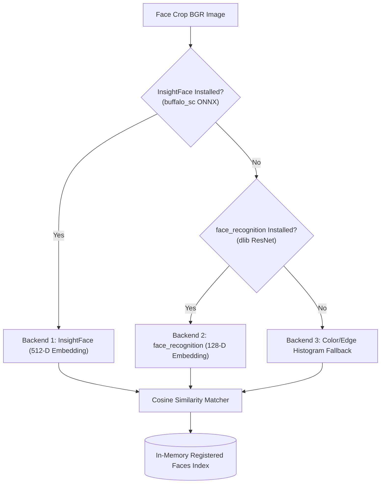

# 👤 Recognition Subsystem (`backend/core/recognition/`)

The Recognition module manages facial biometric feature extraction, prototype indexing, identity verification, and roster matching. It is implemented in [face_engine.py](file:///c:/Users/rajea/Documents/classroom/backend/core/recognition/face_engine.py) and [face_recognition_engine.py](file:///c:/Users/rajea/Documents/classroom/backend/core/recognition/face_recognition_engine.py).

---

## 🏛️ Architecture & Backend Waterfall

To ensure zero crashes regardless of platform dependencies, the engine implements a graceful 3-tier backend waterfall:

---

## 🔍 Core Methods & Metrics

### 1. `extract_encoding(face_crop_bgr) -> np.ndarray | None`
- Ingests a cropped BGR facial image.
- Normalizes pixel values and applies face alignment.
- Emits a normalized float vector (512-D for InsightFace, 128-D for face_recognition).
- Returns `None` if the crop does not contain a discernible human face.

### 2. `compare(enc1: np.ndarray, enc2: np.ndarray) -> float`
Calculates similarity between two embedding vectors:
- **InsightFace**: Normalized Dot Product (Cosine Similarity):
  $$\text{Sim}(\vec{u}, \vec{v}) = \frac{\vec{u} \cdot \vec{v}}{\|\vec{u}\| \|\vec{v}\|}$$
- **face_recognition (dlib)**: Converts Euclidean distance $d$ into similarity:
  $$\text{Sim} = \max\left(0.0, 1.0 - \frac{d}{1.2}\right)$$
- Normalizes all output scores into a standardized $0.0 \dots 1.0$ range.

### 3. `match(face_crop_bgr, threshold: float = 0.50)`
Compares candidate face crop against all enrolled student vectors stored in memory:
- Iterates across cached prototypes.
- Identifies the top candidate $S^* = \arg\max_i \text{Sim}(E_{\text{crop}}, E_i)$.
- Returns `(matched_student, similarity_score)` if $\text{score} \ge \text{threshold}$, else `(None, score)`.

---

## 🛡️ Verification Thresholds

| Threshold Level | Value | Usage Context |
| :--- | :--- | :--- |
| **Strict Authentication** | $\ge 0.75$ | Single-frame instant check-in. |
| **Continuous Verification** | $\ge 0.50$ | Used during runtime lecture tracking in conjunction with temporal confirmation. |
| **Candidate Association** | $\ge 0.40$ | Fallback candidate score for seat re-confirmation when illumination drops. |
| **Reject / Unknown** | $< 0.40$ | Person is designated as visitor / unverified student. |
