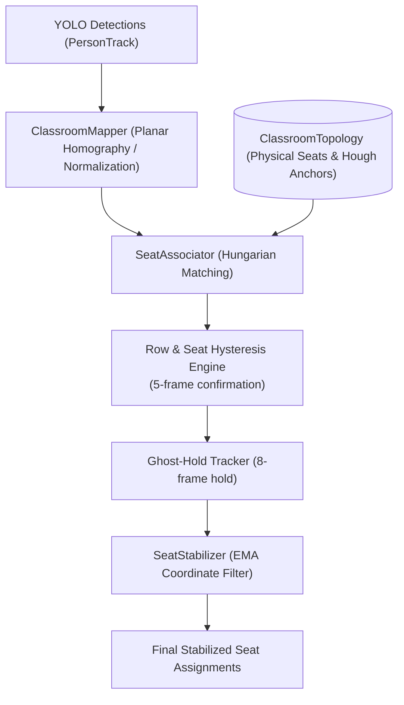

# 🪑 Spatial Reasoning Subsystem (`backend/core/spatial/`)

The Spatial Reasoning subsystem is responsible for mapping pixel-space computer vision tracks into permanent, physical classroom seating coordinates. It handles camera perspective distortion, row clustering, bipartite seat assignment, and coordinate smoothing.

---

## 📂 Subsystem File Map

| File | Primary Classes / Functions | Responsibility |
| :--- | :--- | :--- |
| [spatial_engine_v3.py](file:///c:/Users/rajea/Documents/classroom/backend/core/spatial/spatial_engine_v3.py) | `SpatialEngineV3`, `PhysicalSeat` | Next-generation geometric classroom topology discovery via Hough edge transforms. |
| [seat_associator.py](file:///c:/Users/rajea/Documents/classroom/backend/core/spatial/seat_associator.py) | `SeatAssociator`, `SeatAssignment` | Decoupled Hungarian bipartite matching, hysteresis, and ghost-hold logic. |
| [seat_naming.py](file:///c:/Users/rajea/Documents/classroom/backend/core/spatial/seat_naming.py) | Standardized naming utilities | Converts numerical indices into `R1C1`, `R1-B1-L`, and sequential display seat names. |
| [topology.py](file:///c:/Users/rajea/Documents/classroom/backend/core/spatial/topology.py) | `ClassroomTopology`, `TopologyConfig`, `TopologyDiscovery` | Master data container for classroom physical layout and dimensions. |
| [stabilizer.py](file:///c:/Users/rajea/Documents/classroom/backend/core/spatial/stabilizer.py) | `SeatStabilizer` | Exponential Moving Average (EMA) bounding box coordinate stabilizer. |
| [classroom_mapper.py](file:///c:/Users/rajea/Documents/classroom/backend/core/spatial/classroom_mapper.py) | `ClassroomMapper` | Perspective coordinate normalization and planar projection. |
| [spatial_engine.py](file:///c:/Users/rajea/Documents/classroom/backend/core/spatial/spatial_engine.py) | `SpatialEngine` | Legacy v1/v2 spatial engine kept for regression compatibility. |

---

## 🎯 Detailed Architectural Flow

---

## 🔬 Core Algorithms

### 1. Hough Desk Edge Detection (`_desk_edge_in_strip`)
Identifies physical furniture edges to derive bench row lengths:
1. Slices a horizontal strip around detected student bottom coordinates: $[y_c - \Delta y, y_c + \Delta y]$.
2. Applies Contrast Limited Adaptive Histogram Equalization (CLAHE).
3. Applies Canny edge detector ($25, 90$) with horizontal morphological dilation.
4. Executes Hough Line Transform (`cv2.HoughLinesP`) to find continuous horizontal desk surfaces.
5. Calculates true bench capacity:
   $$N_{\text{seats}} = \text{round}\left( \frac{\text{DeskEdgeLength}}{\text{SEAT\_WIDTH\_PX}} \right)$$

### 2. Multi-Constraint Hungarian Matching
Formulates person-to-seat assignment as a minimum-cost linear assignment problem:

$$\min \sum_{i} \sum_{j} C_{ij} X_{ij} \quad \text{s.t.} \quad \sum_{j} X_{ij} \le 1, \; \sum_{i} X_{ij} \le 1$$

Where cost $C_{ij}$ penalizes:
- Distance from calibrated face anchor.
- Jumping across row boundaries without prior consecutive evidence.
- Switching away from previously locked seat (hysteresis credit).
