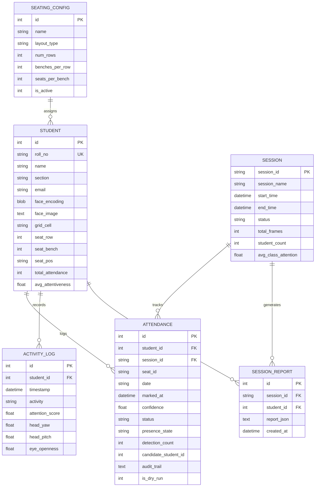

# 💾 Storage & Database Subsystem (`backend/core/storage/`)

The Storage subsystem manages relational data persistence via **SQLAlchemy ORM** over **SQLite 3** (`smartclass.db`). It provides transactional consistency, automatic column migrations, and thread-safe session scoping.

---

## 🗄️ Relational Schema & Models

---

## 🔍 Model Reference

### 1. `Student`
Represents an enrolled student in the institution:
- `face_encoding`: Raw binary bytes of normalized 512-D float32 vector (`numpy.ndarray.tobytes()`).
- `face_image`: Base64-encoded thumbnail for frontend avatar rendering.
- `grid_cell`: Primary registered seat location (e.g. `R1C1` or `R1B2-L`).

### 2. `AttendanceRecord`
Enterprise attendance ledger with verification tiers:
- `status`: Verification outcome (`VERIFIED`, `PENDING_REVIEW`, `REJECTED`, `MANUAL`).
- `presence_state`: Biometric state (`DETECTED`, `CANDIDATE`, `IDENTIFIED`, `UNKNOWN_OCCUPANT`).
- `audit_trail`: JSON evidence string preserving bounding boxes, matching distances, and frame indices.
- `is_dry_run`: `1` if generated during a simulated test, isolating real attendance scores.

### 3. `Session` & `SessionReport`
Audit trail of classroom lecture sessions:
- `session_id`: Unique UUIDv4.
- `report_json`: Structured JSON containing per-student timelines, distraction events, and attention distributions.

---

## 🛠️ Automatic Migrations (`_migrate_add_columns`)

SQLAlchemy's `Base.metadata.create_all()` does not alter existing tables. `init_db()` runs `_migrate_add_columns()`, which queries SQLite's `PRAGMA table_info(<table>)` and applies non-destructive `ALTER TABLE ADD COLUMN` queries dynamically at startup.
