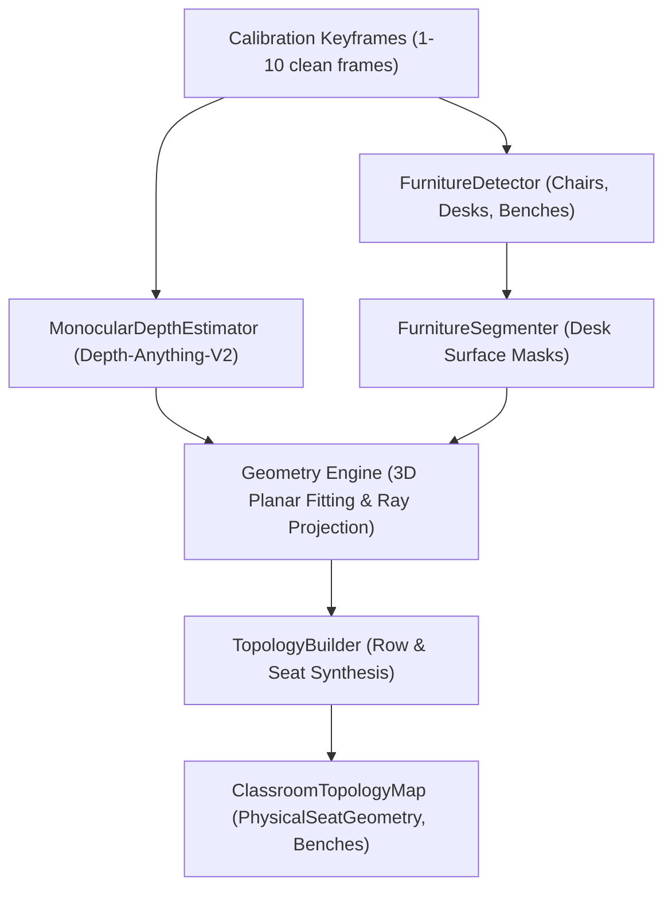

# 🏗️ Structure AI Subsystem (`backend/core/structure/`)

The Structure AI subsystem acts as an independent geometric scene analyzer. It perceives the pure physical geometry of the room (benches, aisles, desk planes, and seat geometries) using detection, monocular depth estimation (**Depth-Anything-V2**), and 3D planar projection.

---

## 🏛️ Subsystem Overview

Structure AI is deliberately decoupled from student tracking. It does not know about student identities, face recognition, or attention scores. Its sole responsibility is generating a permanent `ClassroomTopologyMap`.

---

## 📂 Subsystem File Map

| File | Primary Classes / Functions | Responsibility |
| :--- | :--- | :--- |
| [structure_engine.py](file:///c:/Users/rajea/Documents/classroom/backend/core/structure/structure_engine.py) | `StructureEngine` | Top-level coordinator for structural perception and calibration. |
| [depth.py](file:///c:/Users/rajea/Documents/classroom/backend/core/structure/depth.py) | `MonocularDepthEstimator` | Hugging Face Depth-Anything-V2 monocular metric/relative depth inference. |
| [detector.py](file:///c:/Users/rajea/Documents/classroom/backend/core/structure/detector.py) | `FurnitureDetector`, `FurnitureDetection` | YOLO-based furniture and desk boundary proposal generator. |
| [segmenter.py](file:///c:/Users/rajea/Documents/classroom/backend/core/structure/segmenter.py) | `FurnitureSegmenter`, `FurnitureMask` | Semantic bench surface segmentation and mask contour extraction. |
| [geometry.py](file:///c:/Users/rajea/Documents/classroom/backend/core/structure/geometry.py) | 3D Plane Estimator & Homography | Vanishing point estimation, perspective unwarping, and spatial ray casting. |
| [topology_builder.py](file:///c:/Users/rajea/Documents/classroom/backend/core/structure/topology_builder.py) | `TopologyBuilder`, `ClassroomTopologyMap` | Combines depth, masks, and bounding boxes into indexed physical seat geometries. |

---

## 🔬 Core Algorithms & Data Models

### 1. Monocular Depth Estimation (`MonocularDepthEstimator`)
Uses `depth-anything/Depth-Anything-V2-Small-hf` via PyTorch / Hugging Face Transformers:
- Takes RGB frame normalized to $518 \times 518$.
- Emits dense $H \times W$ float32 depth map where intensity corresponds to inverse distance from camera lens.
- Distinguishes foreground front-row desks from distant back rows even under severe perspective foreshortening.

### 2. 3D Planar Projection & Seat Geometry (`PhysicalSeatGeometry`)
For every discovered desk surface, `TopologyBuilder` computes:
- `seat_id`: Standardized label (e.g. `R1C1`).
- `center_3d`: Estimated $(X, Y, Z)$ spatial coordinate in meters relative to camera frame.
- `head_anchor_2d`: Predicted pixel coordinate $(c_x, c_y)$ where a seated student's face will appear.
- `seat_bounds_2d`: Bounding box of the student interaction zone.
