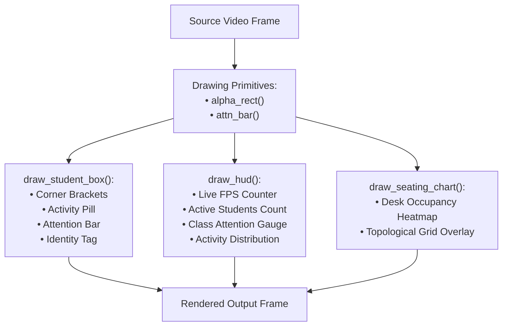

# 🎨 Visualization Subsystem (`backend/core/visualization/`)

The Visualization subsystem ([visualizer.py](file:///c:/Users/rajea/Documents/classroom/backend/core/visualization/visualizer.py)) produces clear computer vision video overlays for live streams, standalone video players, and forensic diagnostic recordings.

---

## 🎨 Color Palette & Activity Badges

Overlays use distinct BGR color mappings:

| Activity State | Badge Text | BGR Color Code | Visual Meaning |
| :--- | :--- | :--- | :--- |
| `studying` | `WRITING` | `(50, 205, 50)` (Emerald Green) | Engaged with notebook/reading material. |
| `attentive` | `FOCUS` | `(50, 205, 50)` (Lime Green) | Direct forward gaze toward lecturer/board. |
| `talking` | `TALK` | `(0, 215, 255)` (Gold Yellow) | Side gaze with mouth movement. |
| `distracted` | `DISTRACT` | `(0, 140, 255)` (Amber Orange) | Looking away from learning zone. |
| `drowsy` | `DROWSY` | `(50, 50, 220)` (Crimson Red) | Eyes drooping or head slumping. |
| `phone` | `PHONE!` | `(50, 50, 220)` (Flashing Red) | Phone detected on desk/hand. |
| `laptop` | `LAPTOP` | `(255, 220, 0)` (Cyan Blue) | Active laptop detected. |

---

## 🖼️ Overlays & Rendering Primitives

---

## 🔍 Key Drawing Functions

### 1. `draw_student_box(img, student, ...)`
Renders tactical HUD bounding brackets around each student:
- Semi-transparent badge background (`alpha_rect`).
- High-contrast corner brackets (avoids obscuring faces).
- Top header: Seat ID + Enrolled Name (e.g. `[S1] Aarav S.`).
- Activity Pill + Color-coded Attention Progress Bar ($0\dots 100\%$).
- Trend Arrow: `▲ UP`, `▼ DN`, `━ STDY`.

### 2. `draw_hud(img, fps, active_count, avg_attention, activity_counts)`
Renders an executive classroom HUD across the top banner:
- Live processing speed (FPS) and session timer.
- Dynamic Class Average Attention progress bar with colored threshold bands ($> 75\%$ green, $55-75\%$ yellow, $< 55\%$ red).
- Active student headcount and activity tally pills (`Focus: 8`, `Study: 3`, `Dist: 1`).

### 3. `draw_seating_chart(img, topology, occupied_map)`
Draws a physical floor plan overlay showing real-time occupancy and vacant desks.
