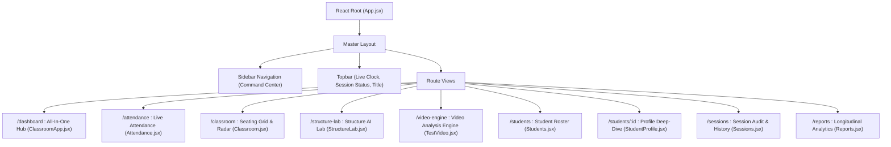

# 💻 Frontend Architecture Overview

SmartClass AI features a high-density, command-center dashboard built with **React 18**, **Vite**, and **React Router 6**. It uses a dark glassmorphic design system tailored for high-contrast classroom monitoring, live video overlays, and telemetry dashboards.

---

## 🎨 Design System & Aesthetics

Implemented in [src/index.css](file:///c:/Users/rajea/Documents/classroom/src/index.css), the UI utilizes custom CSS variables, translucent glass cards, and neon telemetry status accents:

- **Surface Colors**: Deep charcoal and cosmic navy (`#04101e`, `#0a192f`, `#112240`).
- **Glassmorphism**: Backdrop blur filters (`backdrop-filter: blur(12px)`), subtle 1px border glows (`rgba(255, 255, 255, 0.08)`).
- **Accents**:
  - Cyan / Electric Blue (`#38bdf8`): Active navigation and primary interactions.
  - Emerald Green (`#22c55e`): High attention, verified attendance, and online cameras.
  - Amber Yellow (`#f59e0b`): Candidate reviews, talking, and moderate attention.
  - Crimson Red (`#ef4444`): Drowsiness alerts, phone distractions, and unverified visitors.

---

## 🧭 Navigation & Layout

Managed in [src/App.jsx](file:///c:/Users/rajea/Documents/classroom/src/App.jsx):

---

## 🔄 Real-Time State & Telemetry Ingestion

1. **Video Streaming**: Renders native `` or `/api/live-classroom/stream` with automatic retry on disconnect.
2. **Telemetry Heartbeat**: Uses `setInterval` polling (typically $250\text{ms} - 1000\text{ms}$) against `/api/live-classroom/telemetry` to update widget state without full-page re-renders.
3. **Decoupled Control**: Instructors can trigger camera controls, start sessions, review attendance, and assign seats with instant visual feedback.
